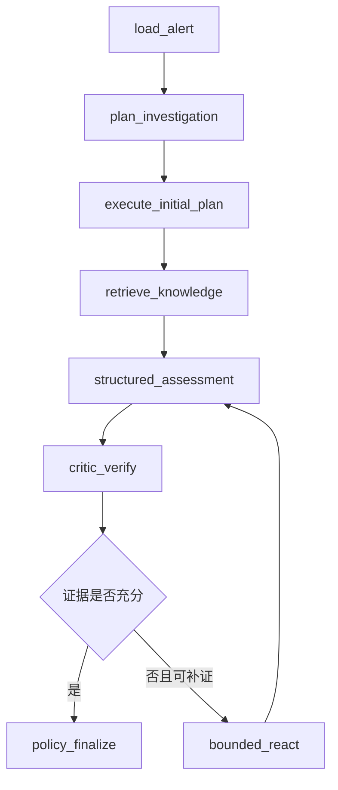

# Agent 运行时设计

当前运行时采用证据驱动的分层混合模式：
`Plan–Execute–Verify–Replan + Bounded ReAct`。主流程保持确定性和可审计性，只有
Critic 判断关键证据不足且仍可通过只读工具补充时，才进入有界 ReAct 子图。

## 主研判图

- `load_alert`：通过 XDR 适配器加载并标准化告警。
- `plan_investigation`：形成网络、端点、身份和知识调查计划。
- `execute_initial_plan`：从平台适配器获取初始多源证据。
- `retrieve_knowledge`：调用 LangChain 只读工具，执行访问标签过滤后的混合检索。
- `structured_assessment`：可选调用 DeepSeek；LangChain 提示模板和 Pydantic
  解析器强制返回结构化研判。
- `critic_verify`：检查证据类型覆盖、冲突、引用和剩余补证预算。
- `bounded_react`：在工具白名单和预算内选择一个只读动作、观察结果并决定停止或继续。
- `policy_finalize`：规则引擎拥有最终裁决权，校验模型引用的证据 ID，并生成只读或
  dry-run 动作建议。

## ReAct 安全边界

- 每个告警最多重规划 1 次；首版 ReAct 子图最多 2 次迭代和 6 次工具调用。
- 工具注册表只包含网络上下文、端点上下文、身份上下文和知识检索。
- 模型输出经过 `Literal` Schema 校验，无法生成任意工具名。
- 工具目标必须来自标准化告警的实体或指标。
- ReAct 不注册隔离、封禁、Shell、SQL 或通用 HTTP 工具。
- Trace 只保存动作选择依据和观察摘要，不保存或展示模型隐藏思维链。
- 达到迭代上限、工具预算、无可用证据或越权时立即停止。
- 补证失败不会提高结论置信度；系统保留未知项并转为人工确认。

每次运行以 API 的 `trace_id` 作为 LangGraph `thread_id`。开发环境使用
`langgraph-checkpoint-sqlite` 将每个节点的状态保存到
`data/runtime/langgraph-checkpoints.sqlite3`，启用 WAL 并允许进程重启后重新加载。

`GET /api/v1/traces/{trace_id}` 返回按执行顺序排列的安全裁剪回放，只包含节点、计数、
后继节点、ReAct 调用数和最终结论，不返回原始证据正文。生产环境可保持接口不变，将
checkpointer 替换为 PostgreSQL。

业务任务层使用独立 SQLite 表持久化 `Case`、`Job`、原始任务请求、结构化结果和追加式
审计事件。服务重启后，相同告警的幂等键仍会返回原任务，`job_id`、`case_id`、`trace_id`
和结果保持不变。`GET /api/v1/jobs/{job_id}/events` 可查询业务状态变更事件。

## LangSmith 门禁

LangSmith 默认关闭。只有同时满足以下条件才会启用：

1. `LANGSMITH_TRACING=true`；
2. 配置了 `LANGSMITH_API_KEY`；
3. 数据是合成或脱敏数据。

真实 XDR 数据默认禁止发送到外部 LangSmith。即使全局追踪已开启，也必须额外显式设置
`LANGSMITH_ALLOW_REAL_SECURITY_DATA=true`；生产环境更建议使用平台批准的自托管观测端点。

## 人工审批图

高风险动作使用独立的 LangGraph interrupt 工作流：先产生审批中断，保存检查点，再由
同一个 `thread_id` 携带审批人、决定和备注恢复。当前版本只实现并验证审批底座，不执行
真实处置。

## 后续扩展

当前调查计划已按网络、端点、身份和知识 Agent 划分。后续 SuperAgent 阶段会将这些计划
步骤升级为可并行执行的专门 Agent，并在共享证据图上增加冲突集、Critic 和最多一次额外
重规划；安全策略和审批图保持不变。
