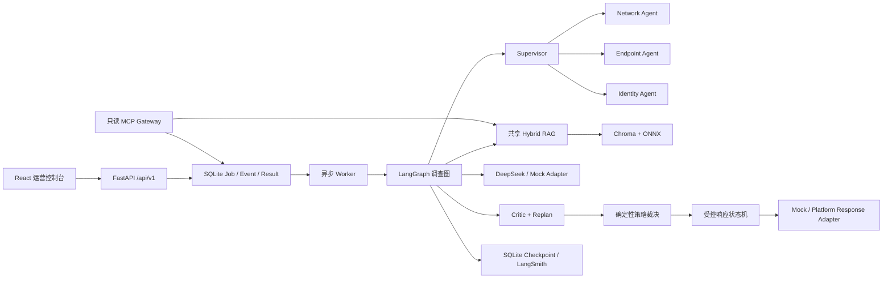

# 架构设计

## 设计目标

系统优先保证研判可解释、写动作可约束、故障可降级、全过程可审计。LLM 负责
结构化判断和补充解释，不拥有最终策略裁决权；确定性策略、工具注册表和审批状态机
共同构成安全边界。

## 调查流程

1. Mock/Platform XDR Adapter 将告警规范化，保留来源和数据分类。
2. Supervisor 生成结构化调查计划，三个专门 Agent 最多三路并行执行只读步骤。
3. 共享 RAG 按访问标签过滤，并行召回 BM25 和向量结果，经 RRF、规则重排和去重。
4. Evidence、AgentReport、Unknown、Conflict 合并到共享状态。
5. Critic 检查跨域覆盖、冲突、引用和预算；必要时生成一次可审计的修订计划。
6. LLM 输出通过 Pydantic 结构化解析；失败时进入确定性 `DEGRADED` 路径。
7. 策略节点限制最终状态和可提议动作，不向前端暴露隐藏思维链。

## 持久化

- SQLite 迁移保留 Job、Result、Checkpoint、审计事件、用户、工作流和响应动作历史。
- 每个 Job 绑定不可变工作流版本，可通过父任务和分析版本追踪重新分析。
- SSE 使用单调事件 ID；断线后通过 `Last-Event-ID` 或 `after` 继续。
- 知识索引按代际构建，`ACTIVE` 指针只在新代完整成功后原子切换。

## 适配边界

核心流程只依赖 XDR、Model 和 Response 协议。当前 Mock Adapter 是可演示实现；平台
资料到达后新增 Platform Adapter 和契约测试，不修改 Agent 的领域模型与安全门。
